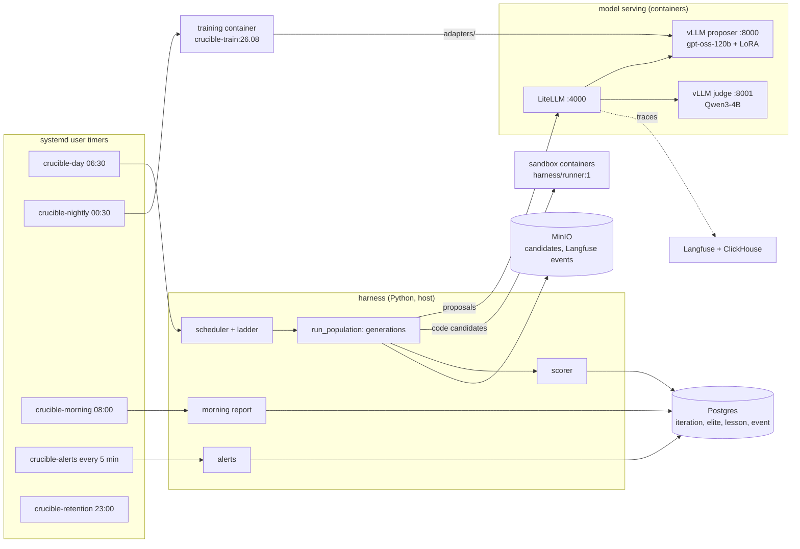

# Architecture, as built

What runs, where, and why it has the shape it has. Every number here was
measured on the machine; where the original plan assumed something different,
the planned value is given beside the built one.

---

## The constraint that shapes everything

The HP ZGX Nano G1n pairs a Blackwell GPU with Grace cores over one 128 GB
unified memory pool (121.6 GiB usable) at 273 GB/s. Decoding a token means
reading the active weights out of that pool, so one request cannot outrun the
bandwidth. A batch reads each weight once and spends it across every sequence
in flight.

Measured for gpt-oss-120b, MXFP4, propose profile (`CAPACITY.yaml`):

| | Planned (published benchmark) | 2026-09-19, 233,350-token KV cache | 2026-11-05, live 92,991-token pin |
|---|---:|---:|---:|
| One stream | 33.5 tok/s | 33.55 tok/s | 37.27 tok/s |
| Knee | | concurrency 32, 173.4 tok/s aggregate | concurrency 16, 142.9 tok/s aggregate |
| Saturation | 862.8 tok/s at 256 | concurrency 64, 201.0 tok/s aggregate | concurrency 16, 142.9 tok/s aggregate |
| Gain, one stream to saturation | 26x | about 6.5x | about 3.8x |

The propose profile is a worst case of 5,120 tokens per request. Real
generations ran 32 requests at a median 221 tok/s and 31% KV use (decision 105).

The ceiling is lower than planned because the weights alone are 82.8 GiB of a
121.6 GiB pool. KV cache capacity, not bandwidth, caps concurrency well before
256. The thesis still holds: throughput comes from concurrency, not speed, so
the search is a **population** of candidates proposed in parallel, never one
agent reasoning in a sequence. A change that reduces concurrency is almost
certainly wrong.

---

## The system

### Services (`compose.yaml`)

Every port binds `127.0.0.1`. None carries authentication; the posture is in
[security.md](security.md).

| Service | Image | Port | Role |
|---|---|---|---|
| `vllm-proposer` | `nvcr.io/nvidia/vllm:26.08-py3`, pinned by digest | 8000 | gpt-oss-120b, MXFP4. Proposes candidates, executes text candidates, serves the LoRA adapter as `distilled` |
| `vllm-judge` | same | 8001 | Qwen3-4B. Grades the judged part of `capability_case` |
| `litellm` | `ghcr.io/berriai/litellm:main-stable` | 4000 | Routes by role: `proposer`, `judge`, `proposer-distilled` |
| `postgres` | `postgres:17` | 5432 | The archive and the event log, database `crucible` |
| `redis` | `redis:7` | 6379 | Langfuse's queue |
| `minio` | `cgr.dev/chainguard/minio` | 9002 (S3), 9091 (console) | Candidate artifacts, Langfuse raw events |
| `clickhouse` | `clickhouse-server:25.12` | 8123, 9000 | Langfuse's trace store |
| `langfuse-web`, `langfuse-worker` | Langfuse v3 (v4's ingestion API breaks LiteLLM) | 3000 | Traces of every model call |
| `prometheus`, `grafana` | | 9090, 3001 | vLLM metrics; queue depth is the number to watch |

### Serving configuration that matters

Check `compose.yaml` for current values; these were current on 2026-10-25.

| Flag | Proposer | Judge | Why |
|---|---|---|---|
| `--gpu-memory-utilization` | 0.74 | 0.09 | Both engines and the OS share one pool. Planned 0.70; moved three times as needs changed |
| `--kv-cache-memory-bytes` | 3,649,830,912 (6,188 blocks) | 9,805,234,176 | Pinned, because vLLM sizes the KV cache from whatever is resident at start and produced 0.06 to 18 GiB from the same flag in one evening |
| `--max-num-seqs` | 256 | 64 | Batch width |
| `--max-model-len` | 65,536 | 16,384 | |
| LoRA | `--enable-lora --max-loras 4 --max-lora-rank 32`, runtime loading on | none | The slow loop hot-swaps adapters without a restart |

Client timeouts are 1,200 s. At high concurrency one sequence decodes at a few
tokens per second, and a short timeout kills healthy requests in a way that
looks like a server fault.

---

## The harness

Plain Python on the host, in `.venv`. No workflow engine: Temporal was planned
for durability and deliberately not built (decision 18), because long
unattended runs completed cleanly without it and a lost generation costs
minutes.

| Concern | Modules |
|---|---|
| Onboarding and the solution contract | `onboarding.py`, `cli.py`, `adapter.py`, `types.py`, `incumbent.py`, `split.py` |
| Scoring | `fitness.py` (frozen), `scorer.py`, `judge.py`, `held_out.py`, `validate.py` |
| Execution | `sandbox.py`, `sandbox_pool.py`, `storage.py` |
| Search | `proposal.py`, `generation.py`, `run_population.py`, `archive.py`, `islands.py`, `selection.py`, `budget.py` |
| Hill climb (Phase 2, kept) | `loop.py`, `run.py`, `report.py` |
| Reflection (built, off by default) | `taxonomy.py`, `lessons.py`, `learning_metrics.py` |
| Distillation | `train/harvest.py`, `train/distil.py`, `ab.py`, `capability.py`, `diversity.py`, `gate.py` |
| Running unattended | `scheduler.py`, `ladder.py`, `events.py`, `morning.py`, `alerts.py`, `retention.py`, `halt.py` |
| Records and reports | `persistence.py`, `generation_report.py`, `metrics.py` |

How a generation works is in [search.md](search.md). How the slow loop works
is in [distillation.md](distillation.md). How it all runs without you is in
[operations.md](operations.md).

### Data stores

| Store | Holds | Kept |
|---|---|---|
| Postgres `iteration` | One row per candidate: lineage, scores, descriptors, the proposer's full context (`proposal`), which proposer arm | Forever |
| Postgres `elite` | The MAP-Elites archive: one row per occupied cell per island per `solution_id`. Experiments are parked by relabelling `solution_id` | Forever |
| Postgres `lesson` | The reflection store | Forever |
| Postgres `event` | Held-out results, ladder steps, gate decisions, alerts, reports written and read | Forever |
| MinIO `candidates` | Candidate text by sha | Elites and anything ever claimed forever, the rest 30 days |
| Langfuse (ClickHouse + MinIO) | Traces of every model call | 90 days |
| `adapters/` | LoRA adapters with their training manifest and capability result | Forever |
| `solutions/<id>/` | Each solution's contract, incumbent, checks and task data | Git |

---

## Planned against built

The plan picked components before anything was measured. What survived:

| Layer | Planned | Built | Why |
|---|---|---|---|
| Engine | vLLM | vLLM, NVIDIA's container | As planned |
| Gateway | LiteLLM | LiteLLM | As planned |
| Durability | Temporal | None | Decision 18 |
| Code search | OpenEvolve | Own MAP-Elites with islands | The archive, islands and selection are a few hundred lines; owning them made every measurement defect fixable |
| Prompt search | GEPA | Not built | Needs a fourth data split no solution could supply (PHASE-4 task 4.4) |
| Scoring | Inspect AI, promptfoo | Own three-tier scorer | Gates, programmatic checks, judge |
| Sandbox | Podman rootless | Docker | Podman not installed; rootless needed sudo-gated setup (decision 14) |
| Store | Postgres + pgvector | Postgres, no pgvector | Embeddings did not fit in memory |
| Embedding model | Qwen3-Embedding-0.6B | TF-IDF | No third CUDA process can initialise beside proposer and judge (decision 34) |
| Worker model | Qwen3-Coder-30B-A3B | The proposer | Text candidates run on the proposer; a 4B worker could not execute a conditional rule (decisions 56, 57) |
| Fine-tune | Unsloth | Unsloth QLoRA in NVIDIA's PyTorch 26.08 container | As planned |
| Experiments | MLflow, Optuna, TRL | Not used | Never needed |
| Sandbox pool | 16 GB, 2 GB per slot | 8 slots at 256 MB | Measured candidate footprint (decision 17) |
| Candidates per generation | 64 | 32 (4 islands of 8) | Sized to the measured knee of 32 |
