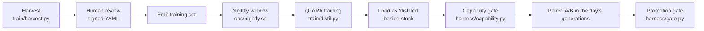

# Distillation, the slow loop, as built

The fast loop rewrites the solution. The slow loop rewrites the proposer: it
trains a LoRA adapter on the search's own successful proposals and serves it
beside the stock model. All of it is built and validated end to end; whether
it improves the proposer is still untested (see the end).

---

## The round

| Step | What it does |
|---|---|
| Harvest | Training examples are claims: the exact context the proposer saw and the proposal that claimed an archive cell. Filters, in order: scalar at least 0.50, near-duplicate removal (cosine 0.90), at most 40 per failure category. The selection is hashed, so it is reproducible |
| Review | A person reads `train/reviews/<selection>.md`, excludes anything that won by exploiting the fitness, and signs `<selection>.yaml`. `emit` refuses an unsigned or stale review. This step stays manual permanently |
| Nightly window | Stops judge and proposer, evicts the weights from the page cache, waits for 105 GB of `MemFree`, trains, restores proposer then judge, loads the adapter. A selection already trained is skipped, so a scheduled nightly does not retrain the same data |
| Training | Unsloth QLoRA, r=16, attention projections, one epoch, response-only loss, in `crucible-train:26.08` (NVIDIA PyTorch 26.08, pinned by digest). A deadline stops training 20 minutes before the window closes |
| Serving | The adapter loads at runtime under the stable name `distilled`; LiteLLM routes `proposer-distilled` to it. Rollback is one `unload_lora_adapter` call |
| Capability gate | 50 fixed general-capability items in five families. Stock reference: 20 passes, 88.6%, sd 0.039. An adapter runs 5 passes; it is rejected beyond 2 sigma of regression, and an apparent regression of 3% or more is retested |
| A/B | While an adapter is loaded and ungated, every generation is paired: one proposal per parent per arm, byte-identical prompts, arm order shuffled. After 10 paired generations the gate decides |
| Promotion gate | All four, or no promotion: quality paired above 2 sigma; capability passes; diversity ratio at least 0.90; tokens per claim no worse than stock. A rejection unloads the adapter. A rotation win waits for a by-hand held-out confirmation, since none has happened yet |

---

## Round 1, 2026-10-17/18

| | |
|---|---|
| Training set | 187 reviewed examples from 372 claims (5 excluded on review) |
| Training | 12 steps, 31 minutes plus 5.6 minutes to load, peak 65.7 GB |
| Capability | 90.8% against the 88.6% reference: no forgetting |
| A/B | +0.0054 rotation scalar over 150 pairs, se 0.0147, +0.37 sigma |
| Cost | 13% more proposal tokens per claimed cell |
| Gate | **Rejected**, and left rejected |

---

## What it took to make the window work

| Problem | Fix |
|---|---|
| Page cache is not free memory to CUDA: tens of GB "available" could not be allocated | `ops/evict_cache.py` (posix_fadvise), then wait on `MemFree` |
| gpt-oss-120b's QLoRA load does not fit beside the judge | The window stops both servers |
| vLLM sized the KV cache from whatever was resident, so restarts came back different and starved the judge | KV caches pinned in bytes in `compose.yaml` |
| A dropped `num_items_in_batch` scaled the loss 16x | Passed through in `WeightedTrainer.compute_loss` |
| transformers 5 removed `warmup_ratio` | `warmup_steps=0.03` |
| Adapter directories written as root | `chown` through the training image |

---

## The thesis is untested, not refuted

The only adapter was distilled from noisy selections before the solutions
saturated. Since then, both judged solutions reached their ceilings once the
proposer was given their written standard (0.972 and 0.977), leaving no
headroom for an adapter to show (decision 88). `ot_change_scheduler` is the
first solution with a deep gradient; if the ladder reaches step 3 there, it
asks for a distillation round, and that round is the real test.
