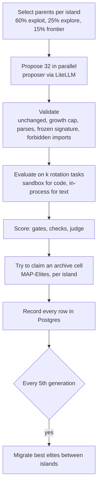

# The search, as built

How one generation turns an archive into better candidates, and the measured
lessons that shaped each part. Decision numbers refer to
[decisions.md](decisions.md).

---

## One generation



`harness/run_population.py` runs generations until its budget ends, then
scores the best-ever candidate on the held-out set twice and records the
result as an event. The scheduler calls it in segments
([operations.md](operations.md)); `ops/search.sh` calls it for one-off
experiments.

---

## The parts

### Proposal (`proposal.py`)

The proposer returns a full replacement for the code between the
`EVOLVE-BLOCK` markers, wrapped in `<candidate>` tags: never a diff, never
code inside JSON. The prompt carries, in order: a system prompt (code or
text variant), the task description, the parent, inspirations from other
cells, the parent's score, and where it lost points. Invariant text comes
first so the prefix cache can reuse it: reordering it raised the cache hit
rate from 33.7% to 61.5% (decision 49).

**The task description includes the solution's written standard** (onboarding
question eight). This was the largest single gain in the project:
`capability_case` went from held-out 0.59 to 0.972 once the proposer was told
the rule it was searching for (decision 79). Search should spend its effort
on what cannot be written down.

### Validation (`validate.py`)

A proposal is inadmissible if it is unchanged, grew past the solution's cap
(default 3x; text solutions 15x, `ot_change_scheduler` 8x), fails to parse,
redefines the frozen entrypoint, or imports the scorer, fitness or task
modules. A short seed legitimately grows several-fold, which is why solutions
set their own cap.

### Execution

- **Code** runs in a Docker container (`harness/runner:1`): no network,
  read-only root filesystem, 64 MB tmpfs, memory and pids capped, all
  capabilities dropped, killed at the wall-clock limit twice (in the container
  and by the parent). Eight slots run in parallel.
- **Text** candidates are instructions; the adapter sends them to the
  proposer model as a worker.

### Scoring (`scorer.py`, `fitness.py`)

Three tiers. A gate failure makes the candidate invalid. Programmatic checks
are averaged into quality. Where the adapter says a check cannot decide, the
judge grades the output and takes 30% of quality.

Quality is **class-balanced** where a solution defines classes: the mean of
per-class means, with tasks sampled stratified by class and without
replacement inside a class. Without it, a constant policy scored well purely
from task-set composition (decisions 52, 53).

The scalar the archive ranks on:

```
scalar = quality - 0.10 x min(cost_tokens / 4000, 2) - 0.05 x min(latency_s / 10, 2)
```

`fitness.py` is frozen and outside every mutation surface.

### How many tasks per candidate

Each candidate is scored on `tasks_per_candidate` rotation tasks, set per
solution in `BASELINE.yaml`. One task ranked candidates on different work;
three made scores so coarse the search overfit rotation; 18 resolved real
differences (decisions 40, 59, 60, 78).

### The archive (`archive.py`, `islands.py`, `selection.py`)

MAP-Elites on a 6 x 6 grid per island, four islands. Two descriptors per
solution place a candidate in a cell; they are never optimised. A candidate
claims a cell if the cell is empty or it beats the occupant. Every fifth
generation each island's best migrates to the next island, which measurably
restored lineage diversity that selection had collapsed (decision 45).

### Held-out

Every solution's tasks split by `sha256(task_id) % 100`: 10% dev, 45%
rotation, 45% held-out. Held-out is sealed with a committed checksum and
never reaches the search. Its result is stamped with `eval_set_version()`, a
hash of the held-out files, so scores are compared only within one eval set.

---

## Reflection: built, measured, off

Phase 4 built a failure taxonomy (TF-IDF plus k-means, 99.3% assignment), a
lesson store with admission rules and two-sigma retirement, and two-tier
lesson injection. It is off by default (`lessons=False`).

| Measurement | Result |
|---|---|
| First ablation | Lessons 7.4 sigma worse on held-out, but run on a mis-wired solution (decisions 46, 56) |
| Re-run on the sound configuration, three looks | Lessons ahead by 0.15 to 0.19, significant in none (decisions 64, 65) |
| Pre-registered fresh run | Inconclusive by its own criteria (decision 68) |
| Search run-to-run variance | sd 0.0228 on held-out, the number every comparison needed (decision 48) |

Lessons stay off as unproven rather than harmful. GEPA was not built: prompt
evaluation needs a fourth split, and no solution had enough tasks for one.

---

## What the searches found

The lesson repeated across every solution: **a search finds whatever the
fitness does not measure**, and reading the winners is how the gaps were
found.

| Gap | Found by | Fix |
|---|---|---|
| A constant "never reject" policy scored well from task composition | Splitting held-out by class (decision 52) | Class-balanced quality |
| A third of candidates discarded for output formatting | Classifying failures (decision 66) | Fixed the parser |
| capability_case_author's winner always recommended "Proceed" | Reading the promoted candidate (decision 84) | A fifth check, `recommendation_calibrated` |
| Candidates scored on one lucky task | The retrieved lesson tier never firing (decision 40) | k tasks per candidate |

The weekly elite read in [operations.md](operations.md) exists because of
this table.
